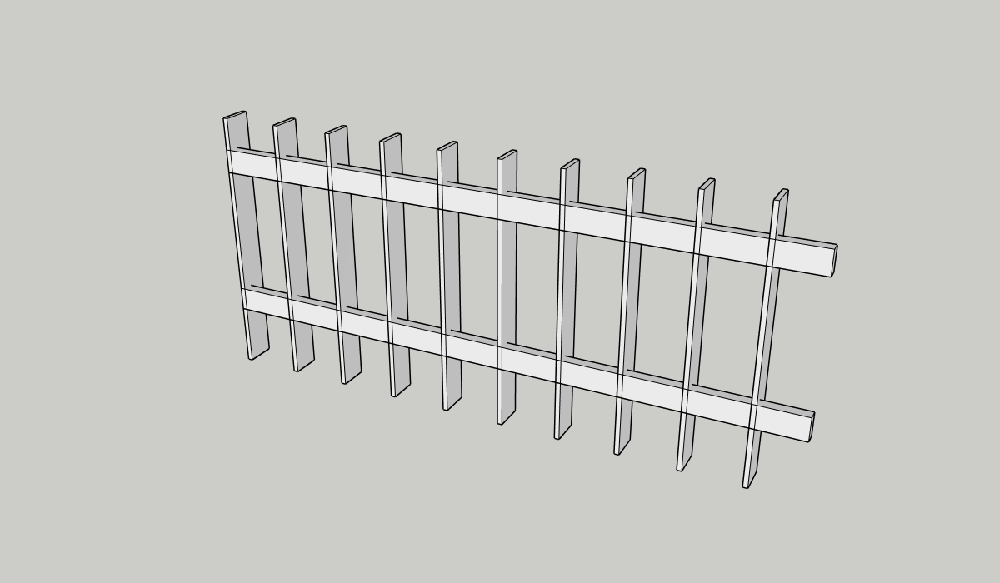
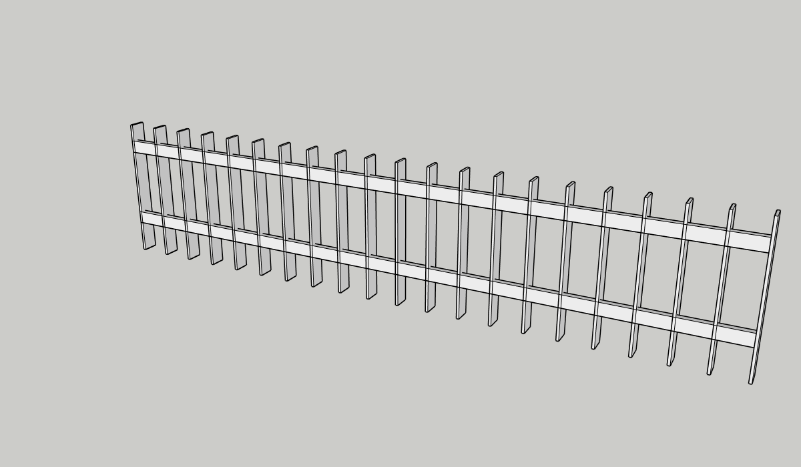

# Open DC — a modern Dynamic Components replacement for SketchUp

**Status:** beta 1 (`v0.1.0`). Part of the
[Open SketchUp](https://github.com/jurej/open-sketchup-framework) ecosystem.

Open DC gives SketchUp's Dynamic Components a modern parameter panel and adds
capabilities the classic extension can't do:

| Feature | Status |
|---|---|
| Modern parameter panel (search, sections, tooltips, drag-reorder) | beta 1 |
| Batch-edit one parameter across many selected DCs at once | beta 1 |
| Formula editor: pills, autocomplete, live validation, function reference | beta 1 |
| Expression node-graph editor (visual formula building) | beta 1 |
| Interactive dependency graph (wire attributes, edit links) | beta 1 |
| Open engine (`open_dc`) — deterministic evaluation, `global!` cross-component links | beta 1 (opt-in Convert) |
| Native SketchUp props as attributes — `sketchup!name`, `sketchup!layer` … | beta 1 |
| Foreign attribute dictionaries — `su_instanceset!price`, `DICTATTR()` | beta 1 |
| Formula **drivers**: fx on writable native props / dict keys | beta 1 |
| Read-only input scopes `model!` and `scene!` | beta 1 |
| Convert plain (non-dynamic) components; live recompute on scale/move/rotate | beta 1 |
| Reusable presets / partial component definitions | planned (beta 2) |
| Scale-tool semantics (directional scale flags) | planned (beta 2) |

**Feature tour with screenshots:** [docs/features.md](docs/features.md)

| Parametric picket fence — before | After `width` ×2 (pickets auto-respawn) |
|---|---|
|  |  |

## Two engine modes

- **Classic mode** — the panel reads and writes the normal
  `dynamic_attributes` format and asks Trimble's engine to redraw.
  Components stay 100 % portable (SketchUp Web, iPad, users without this
  plugin).
- **Open DC mode** — opt-in per component via *Extensions → Open DC →
  Convert to Open DC* (works on plain components/groups too — no prior
  attributes needed). Our own sandboxed formula engine evaluates a
  `dynamic_attributes`-compatible dialect plus `global!name` references
  (model-level parameters — links across separate components),
  `sketchup!prop` native properties, foreign dictionaries via
  `dictname!key`/`DICTATTR()`, and read-only `model!`/`scene!` globals.
  Writable props and dict keys can carry **driver formulas** that push
  computed values back into SketchUp. Convert/Revert round-trips through
  a stored snapshot.

## Install

Dev: `powershell -File scripts/install_dev.ps1`
Package: `powershell -File scripts/build_rbz.ps1` → `dist/*.rbz`, install via
*Extensions → Extension Manager → Install Extension*.

Requires **SketchUp 2024+** (Windows/Mac).

## Use

- *Extensions → Open DC → Parameter Panel* — live parameter editor with two
  audiences in mind:
  - **Options view** (default): clean consumer-facing list — just the
    parameters meant to be changed, grouped under labeled section
    dividers, with `ⓘ` tooltips on hover. No admin controls.
  - **Configure mode** (⚙ gear in the toolbar): the author view — formula
    editing, units, display rules, option lists, tooltips, attribute
    ordering, sections, rename, add/delete attributes, engine convert.
    Two extra foldable sections appear here only: **SketchUp** (native
    entity properties, read + fx-drivable writes) and **Attribute
    dictionaries** (every other dictionary on the entity, grouped and
    pickable — no hand-typed names).
  - **Sections**: hover between rows in Configure and click `+ divider`
    to split a group; click a divider's name to rename, `×` to remove,
    drag the `⠇` grip to reorder. Stored as classic `&Title&` markers in
    `_itemorder`.
  - **Display rules** map to classic access levels: `edit` (TEXTBOX),
    `list` (LIST), `view only` (VIEW), `hidden` (NONE).
  - **Formula editing** (`fx` on a row): free text with inline pills —
    attributes, `scope!` refs, functions and keywords render as chips
    while you type around them. Caret-aware autocomplete offers
    attributes, `global!` refs and every real function; `ƒ(x)` opens the
    syntax reference; `⨂` opens the expression as a **node graph**
    (Rete.js) — wire boxes instead of typing, with inline values on
    unconnected inputs and a fixed FORMULA output node. Live validation
    through the real parser explains errors in plain language
    ("'Valles GAL2' looks like a text value - wrap it in double quotes")
    and blocks invalid saves.
  - **Dependency graph** (Configure → graph button): every attribute as a
    node — including formula-less parameters and builtins, which become
    wire targets (the edge writes + adopts a formula for you). Drag
    `out → deps` to rewire a formula, Del on an edge to unlink,
    double-click a node to open its formula canvas. Cycle-safe.
  - **Batch edit**: select multiple DCs → a shared-parameter section
    appears (`<mixed>` = values differ). Typed values are type-checked —
    numeric fields reject text, lists reject non-options, with
    descriptive errors; `10cm`/`18"` literals convert correctly.
- *Extensions → Open DC → Interact Tool* — click a DC to run its `onClick`
  formula (editable as a first-class attribute row; works on nested
  children: the click bubbles up to the first ancestor with `onClick`,
  like the classic Interact tool). Supports `SET`, `REDRAW`, `ALERT`,
  `GOTOSCENE` on both engines; `ANIMATE*` steps directly to the next
  state (interpolation is a follow-up).
- *Extensions → Open DC → Convert / Revert* — switch engines per
  component; plain (non-dynamic) components convert directly.
- *Recompute Selected* — manual redraw/evaluate. Moving, scaling or
  rotating a converted component with normal SketchUp tools recomputes
  automatically — `lenx`/`leny`/`lenz` track real `x/y/zscale`.

## Formula language (Open DC mode)

```
10cm  25.4mm  2'  4"        # lengths → inches
"text" & value              # string concat
+ - * / % ^  = <> < > <= >= AND OR NOT
attr  parent!attr  name!attr  global!attr          # references
sketchup!name  sketchup!layer                      # native entity props
su_instanceset!price  DICTATTR("dict","key")       # foreign dictionaries
model!units  scene!name                            # read-only globals
IF CHOOSE CURRENT MIN MAX ROUND INT FLOOR CEILING ABS SQRT
SIN COS TAN ASIN ACOS ATAN PI DEGREES RADIANS
LARGEST SMALLEST OPTIONINDEX OPTIONVALUE NEAREST
SET REDRAW ALERT GOTOSCENE ANIMATE*                # onClick actions
```

`global!` parameters live on the model itself — set them via the console or
future UI: `Sketchup.active_model.set_attribute("open_dc", "height", 100)`.
Writable `sketchup!` props and foreign dict keys accept **driver
formulas**: attach fx in the panel's Configure sections and every
recompute writes the computed value back to SketchUp (e.g.
`sketchup!layer` driven by `IF(width > 100, "heavy", "light")`; unknown
tag names safely fall back to Layer0/Untagged).

## Compatibility

Verified against a real-world library of 24 classic DCs (nested structures,
19-option lists, `NEAREST`, `parent!`/`node!` refs): attributes read in
original order, formulas parse, evaluation matches classic output.
Degenerate values that crash the classic engine (zero-length scales →
singular transforms) are clamped and flagged instead of raising.

## Repo layout

See `AGENTS.md` and `docs/architecture.md`. Unit tests (no SketchUp needed):
`ruby -Itest tests/test_expression.rb` etc.

## License

[GNU AGPL-3.0](LICENSE). Derivative works — including software offered to
users over a network — must be published under the same license with source
code available.
