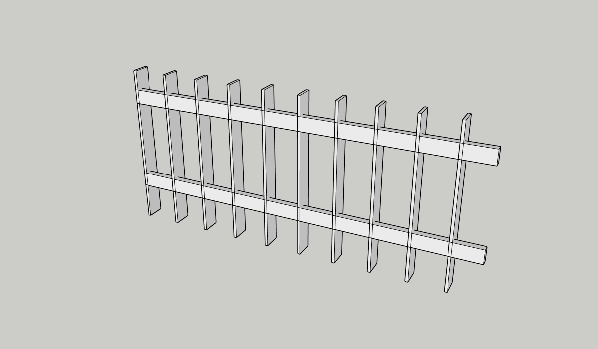
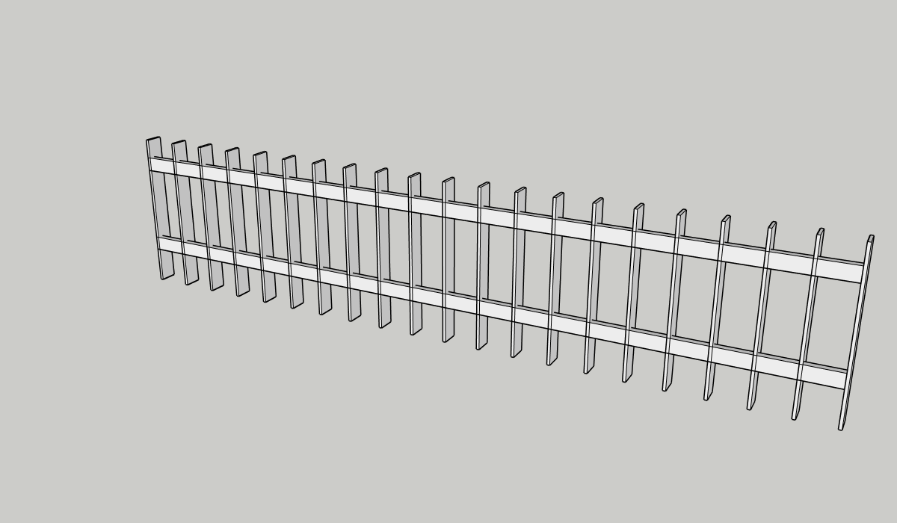
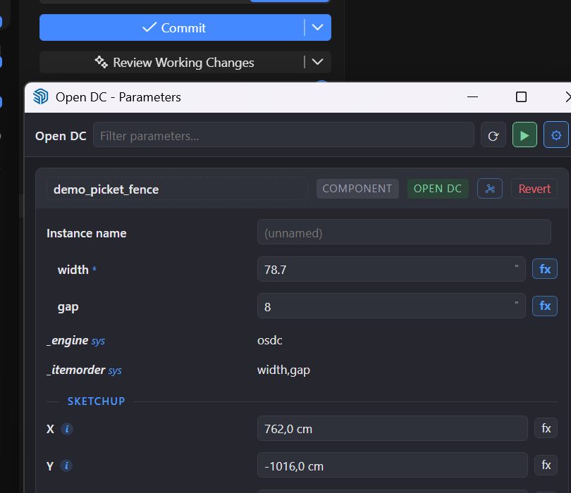

# Open DC — feature tour with examples

Everything below runs inside SketchUp 2024+. Screenshots are from the
demo model `testDC.skp`.

## Parametric content: the picket fence

A fence component where `width` drives both the rail length **and** the
number of generated pickets — the pickets are a sub-component multiplied
with `copies`:

```
# on the fence (Open DC mode)
width   = lenx                 # user-facing parameter mirrors the real length
gap     = 8                    # target picket spacing

# on the picket template child
copies  = int(parent!width / parent!gap)   # regenerate picket count
copy    = 0..n → positions via COPY
lenx    = parent!width                      # rails stretch with the fence
```

| Before | After `width` ×2 |
|---|---|
|  |  |

Change `width` in the panel (or scale the component) → the rails stretch
and pickets respawn: 10 → 21 with zero manual cleanup.

## Live recompute on modeling operations

Open DC watches the entity itself, not just attribute dictionaries.
**Scale, move or rotate a component with the normal SketchUp tools and
every dependent formula re-evaluates** — `lenx`/`leny`/`lenz` use the
real `transformation.xscale/yscale/zscale`, not normalized axis vectors.

> Scale the fence 2× with the Scale tool → `width = lenx` updates →
> `copies` recomputes → new pickets appear. No redraw button needed.

Identical writes are skipped, so driven values can't trigger feedback
loops.

## Convert anything — including plain components

*Extensions → Open DC → Convert to Open DC* now works on **any**
component or group, not just existing classic DCs. A plain box converts
directly: Open DC seeds its `open_dc` dictionary, the `_engine` marker
and nominal dimensions — no dummy attribute required first.

## Configure mode — the author view

The gear toggles between a clean Options view (end users) and the full
author surface: formulas, units, display rules, ordering, sections — plus
two foldable sections that never clutter the Options view:



- **`SKETCHUP` section** — native entity properties (`name`, instance
  name, `layer`, `description`, plus read-only `guid`, `persistentid`,
  `entityid`, `typename`, instance count). Writable ones get an **fx**
  button; read-only ones are still usable as formula inputs.
- **Attribute dictionaries** — every *other* dictionary on the entity
  (e.g. `su_instanceset`, `appliedattributes`) grouped per dictionary.
  Scalar values are editable; structured values display read-only.

## Formulas on native properties — "drivers"

Attach a formula to any writable `sketchup!` property or foreign
dictionary key and Open DC drives the real thing every recompute:

```
# stored as the formula of driver attribute sketchup!name
="panel_" & sketchup!entityid        # names the definition automatically

# drive an SU_InstanceSet pricing key from geometry
su_instanceset!price  =  =round(lenx * leny * 0.05, 2)

# tag/layer by formula — an unknown tag safely falls back to Untagged
sketchup!layer  =  =IF(width > 100, "heavy", "light")
```

Broken driver formulas stop driving (they don't keep writing a stale
cache) and surface an `apply:`-prefixed error on the row; clearing the
formula removes the driver. Drivers are **Open DC engine only** — the
panel refuses them on classic components and tells you to convert first.

## Read everything: scoped inputs

Any readable attribute can feed a formula:

```
sketchup!layer            # this entity's native property
su_instanceset!price      # foreign dictionary key (scope syntax)
DICTATTR("mydict","key")  # same thing, function form — dict name as data
model!units               # read-only model globals: name, title, path,
scene!name                # filename, units, lat/lng, north angle,
                          # georeferenced, scenecount + active scene props
global!panel_height       # model-level shared parameters
parent!width  name!attr   # hierarchy references (classic dialect)
root!width                # outermost osdc component, any depth
```

All of these appear as **input-node submenus** in both node editors
(expression graph and dependency graph), in fx autocomplete, and in the
`ƒ(x)` reference. `model!`/`scene!` are read-only scopes.

## Dependency graph with formula-less nodes

Every parameter shows as a graph node — **even with no formula**. Wire a
dependency edge into a formula-less node and the graph writes + adopts
the new formula for you, with cycle detection guarding loops.
Double-click a node to open its expression canvas (functions, scoped
refs, all builtins — including `onClick`).

## Scene graph — wiring components together

The ▦ toolbar button opens a scene-level graph that needs no selection:
every top-level osdc component appears as a node with per-attribute
in/out slots, plus a Globals pseudo-node. Dragging `attr → attr` across
nodes writes the right scope reference into the target's formula
(`name!attr`, or `global!attr` from the Globals node); clicking a link
unlinks back to a literal, and double-clicking a node dives into that
component's own dependency graph. Positions and group boxes persist per
session, same as the per-entity graph.

## onClick actions

`onClick` is a first-class row (with `copies`, `copy`, `scaletool`) —

```
onclick = SET("hidden", TRUE, FALSE)          # toggle visibility
onclick = ALERT("clicked " & sketchup!name)
onclick = GOTOSCENE("Scene 2", 1.0, 0.3)      # camera animation
```

It validates with action functions, stays out of value evaluation, and
fires through *Extensions → Open DC → Interact Tool* — nested clicks
bubble to the first ancestor with `onClick`, matching classic behavior.

## Safe tag handling

Writing a nonexistent tag name to `sketchup!layer` (manually or via a
driver) resolves `model.layers[name]` and falls back to `nil` → SketchUp
maps it to **Layer0 / Untagged** instead of storing a broken reference.
